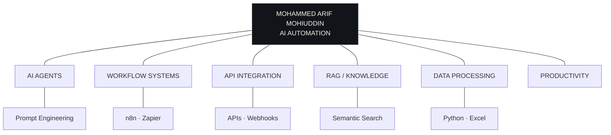

[Uploading README.md…]()

<code>PORTFOLIO — INDEX Nº 001</code>　　　　　　　　　　　　　　　　　<code>CHATTOGRAM, BD — 22.36° N</code>

# Mohammed Arif Mohiuddin

### AI Automation Engineer — Chattogram, Bangladesh.

focus · AI · workflow systems · intelligent agents · RAG · API integration 
open to learning · collaboration · building smarter solutions

 

AI & AUTOMATION　　·　　WORKFLOW SYSTEMS　　·　　API INTEGRATION　　·　　INDEPENDENT / 2026

 

[PORTFOLIO](#03--selected-projects)　　[ABOUT](#01--whoami)　　[LINKEDIN ↗](https://www.linkedin.com/in/arifmohiuddin01)　　[GITHUB ↗](https://github.com/arifmohiuddin726-ship-it)　　[EMAIL ↗](mailto:arifmohiuddin726@gmail.com)

---

## `01`　WHOAMI 　　　　　　　　　　　　　　　　　　　　　　　　　`/01-whoami`

I’m passionate about AI and automation, focused on building smarter workflows that reduce repetitive work, save time, and improve productivity.

I work on AI automation and workflow automation to simplify everyday tasks and make business processes more efficient. My goal is to turn repetitive tasks into smooth, reliable workflows.

I’m actively developing my skills through learning and hands-on practice, with a focus on practical solutions and real-world projects.

FOCUS　·　AI AUTOMATION　·　WORKFLOW OPTIMIZATION　·　RAG SYSTEMS　·　PROMPT ENGINEERING

| OPERATOR PROFILE | DETAILS |
|:--|:--|
| NAME | Mohammed Arif Mohiuddin |
| ROLE | AI Automation Engineer |
| BASE | Chattogram, Bangladesh |
| STATUS | Learning / Building / Improving |
| INTERESTS | AI agents, workflow automation, APIs, knowledge systems |

---

## `02`　SYSTEM MAP 　　　　　　　　　　　　　　　　　　　　　　　　`/02-system-map`

A map of the tools and ideas I connect through automation.

● ACTIVE INTEREST　　·　　6 CONNECTED DOMAINS

---

## `03`　SELECTED PROJECTS 　　　　　　　　　　　　　　　　　`/03-projects`

Practical systems and experiments built around useful automation.

### `01 / JOB AUTOMATION`

**LinkedIn Job Alert Automation System**　`COMPLETED`

An intelligent automation system that streamlines job hunting by monitoring LinkedIn opportunities and delivering timely alerts.

- **Overview** — Automate job hunting with intelligent monitoring and alerts.
- **Features** — Keyword filtering · Instant notifications · Automated applications
- **Stack** — `n8n` `LinkedIn API` `Webhooks` `Email`
- **Tags** — `LINKEDIN` `JOB SEARCH` `AUTOMATION`

---

### `02 / HEALTHCARE AI`

**AI Email Automation System**　`COMPLETED`

An intelligent email automation system designed for dental clinics to handle patient communications and appointments.

- **Overview** — Streamline dental clinic operations with AI-powered email management.
- **Features** — Appointment scheduling · Patient inquiries · Automated reminders
- **Stack** — `n8n` `Gmail API` `OpenAI`
- **Tags** — `HEALTHCARE` `EMAIL AI` `N8N`

---

### `03 / DATA PROCESSING`

**Automated Excel Data Processing System**　`COMPLETED`

An intelligent data-cleaning system that processes, validates, and standardizes Excel data with AI-powered quality checks.

- **Overview** — Transform messy data into clean, structured datasets automatically.
- **Features** — Duplicate removal · Format standardization · Error detection · Validation
- **Stack** — `n8n` `Excel API` `Python`
- **Tags** — `DATA VALIDATION` `EXCEL` `DATA CLEANING`

---

### `04 / IMAGE AI`

**AI-Powered Image Discovery Agent**　`COMPLETED`

An image-search automation that finds, filters, and downloads images using AI-powered content recognition and quality assessment.

- **Overview** — Automate image discovery and collection with AI intelligence.
- **Features** — Smart search · Quality filtering · Batch downloading · Content recognition
- **Stack** — `n8n` `Image APIs` `AI Vision`
- **Tags** — `IMAGE AI` `SEARCH` `AUTOMATION`

---

### `05 / AI AUTOMATION`

**AI Travel Assistant using MCP**　`COMPLETED`

An intelligent travel planning assistant powered by MCP that helps users discover destinations, generate itineraries, and simplify travel planning.

- **Overview** — AI-powered trip planning and destination discovery.
- **Features** — Destination recommendations · Smart itinerary generation · Travel information assistance
- **Stack** — `MCP` `AI` `n8n` `API Integration`
- **Tags** — `MCP` `TRAVEL AI` `AUTOMATION`

---

### `06 / AI ASSISTANT`

**Smart Student Assistant**　`COMPLETED`

An AI-powered student assistant that helps learners manage academic tasks, answer questions, organize study materials, and improve productivity.

- **Overview** — AI-powered academic assistance and study management.
- **Features** — Academic assistance · AI-powered Q&A · Study management · Productivity support
- **Stack** — `AI` `n8n` `LLM` `API Integration`
- **Tags** — `EDUCATION` `AI` `ASSISTANT`

---

### `07 / AI AUTOMATION`

**AI Knowledge Base Support Agent**　`COMPLETED`

An enterprise-grade RAG-powered customer support assistant built with n8n. It processes documents from Google Drive, stores embeddings in Supabase Vector Store, retrieves relevant knowledge through semantic search, generates responses with Groq LLM, and sends Gmail replies with optional Human-in-the-Loop approval.

- **Overview** — Enterprise RAG-powered customer support with intelligent knowledge retrieval.
- **Features** — Document processing · Semantic search · AI response generation · Human approval workflow
- **Stack** — `n8n` `Groq LLM` `Gemini` `Supabase` `RAG` `Gmail API`
- **Tags** — `RAG` `AI AGENT` `VECTOR DB`

---

### `08 / YOUTUBE AUTOMATION`

**YouTube Content Automation System**　`COMPLETED`

A comprehensive automation workflow for YouTube content creation, from script generation to video publishing and optimization.

- **Overview** — Streamline YouTube content production with AI-powered automation.
- **Features** — Script generation · Thumbnail creation · Video scheduling · SEO optimization · Analytics tracking
- **Stack** — `n8n` `YouTube API` `OpenAI`
- **Tags** — `YOUTUBE` `CONTENT AI` `AUTOMATION`

---

## `04`　TELEMETRY 　　　　　　　　　　　　　　　　　　　　　　　　`/04-telemetry`

| METRIC | VALUE |
|:--|--:|
| PROJECTS DOCUMENTED | `08` |
| PRIMARY FOCUS | `AI / OPS` |
| WORKFLOW TOOLS | `n8n · Zapier` |
| KNOWLEDGE SYSTEMS | `RAG · Vector Search` |
| INTEGRATION FOCUS | `APIs · Webhooks` |

**LANGUAGE & TOOLING MAP**

| DOMAIN | CURRENT FOCUS |
|:--|:--|
| AI & LLMs | `████████░░` |
| Workflow automation | `█████████░` |
| API integration | `████████░░` |
| RAG & knowledge systems | `███████░░░` |
| Python | `█████░░░░░` |
| JavaScript | `█████░░░░░` |
| Zapier | `██████░░░░` |

NOTE: The bars show current learning focus, not live analytics or measured proficiency.

---

## `05`　FIELD NOTES / TIMELINE 　　　　　　　　　　　　　　`/05-timeline`

| WHEN | TRACK | NOTES |
|:--|:--|:--|
| `2026 — NOW` | AI AUTOMATION ENGINEER | Learning, experimenting, and building practical AI-powered workflows. |
| `ONGOING` | HANDS-ON PROJECTS | Developing automation systems for job alerts, email, data processing, and AI assistants. |
| `NEXT` | BUILD · ITERATE · SHARE | Turning ideas into reliable solutions and learning through real-world projects. |

---

## `06`　STACK 　　　　　　　　　　　　　　　　　　　　　　　　　　`/06-stack`

**AI & AUTOMATION**

`n8n`　`Zapier`　`AI Agents`　`RAG`　`Prompt Engineering`　`Workflow Automation`

**DEVELOPMENT & INTEGRATION**

`Python`　`JavaScript`　`API Integration`　`Webhooks`　`Gmail API`　`Excel API`

**CURRENTLY EXPLORING**

`MCP`　`Vector Databases`　`LLM Applications`　`Human-in-the-Loop Workflows`

---

## `07`　LET’S CONNECT 　　　　　　　　　　　　　　　　　　　　　`/07-contact`

### Build something smarter.

Interested in AI, automation, or workflow optimization? Feel free to connect with me or send me a message on LinkedIn. I’m always open to learning, sharing ideas, and exploring opportunities to build smarter solutions together.

- **LINKEDIN** — [linkedin.com/in/arifmohiuddin01](https://www.linkedin.com/in/arifmohiuddin01)
- **GITHUB** — [github.com/arifmohiuddin726-ship-it](https://github.com/arifmohiuddin726-ship-it)
- **EMAIL** — [arifmohiuddin726@gmail.com](mailto:arifmohiuddin726@gmail.com)

---

MOHAMMED ARIF MOHIUDDIN　·　AI AUTOMATION　·　2026 
DESIGNED AS A LIVING DOCUMENT

